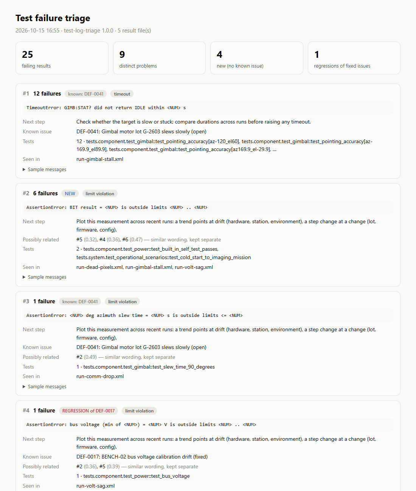
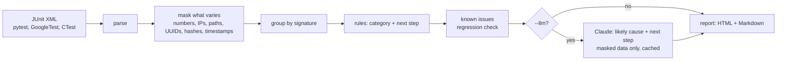

# test-log-triage

[](https://github.com/KyleEGibson/test-log-triage/actions/workflows/ci.yml)


Takes a pile of failing JUnit results and boils them down to a short list of distinct problems. Each one gets a category, a suggested first step, a link to a known issue if there is one, and a regression flag if an issue marked fixed shows up again.

There's also an optional `--llm` flag that asks Claude for a likely cause per problem. It only sends masked summaries, forces the answer into a JSON schema, caches it, and falls back to the rule labels if anything fails.



For example, 25 real failures from five fault-injection runs of my [EOS-100 test station](https://github.com/KyleEGibson/eo-sensor-test-station) come out as 9 problems: 4 new, 4 known, 1 regression.

## How it works

| Stage | Detail |
|---|---|
| Signature | `bus voltage (min of 5) = 24.16 V is outside limits 27 .. 29` becomes `bus voltage (min of <NUM>) = <NUM> V is outside limits <NUM> .. <NUM>` |
| Clustering | exact signatures. Similar ones are shown as "possibly related" instead of merged ([why](docs/clustering.md)) |
| Rules | crash, resource, environment, timeout, communication, data integrity, limit violation, assertion. Checked in order so specific beats generic, and every label comes from a regex you can read. |
| Known issues | YAML file (`samples/known_issues.yaml`) mapping signatures to tracker IDs. A match on a fixed issue is a regression, and `--fail-on-regression` exits 2 for CI. |
| Claude (optional) | one request per 40 clusters, so cost goes with the number of problems, not log size. `claude-opus-5-5` at low effort, JSON-schema output, server-side refusal fallback. Tracebacks are never sent. |

## Clustering accuracy
`triage eval` scores the clustering against a labeled corpus (400 failures from 13 causes, with look-alike pairs and varying hosts/paths/IDs):

| Setting | ARI | Homogeneity | Completeness |
|---|---:|---:|---:|
| exact signatures (default) | 1.000 | 1.000 | 1.000 |
| fuzzy merge < 0.40 | 0.885 | 0.943 | 1.000 |
| fuzzy merge < 0.60 | 0.849 | 0.909 | 1.000 |

My first version used fuzzy merging, and on the real data it lumped three different causes together (BIT, temperature and voltage limit failures). The corpus numbers are optimistic since I wrote the corpus and the rules. [`docs/clustering.md`](docs/clustering.md) has the details and the known limitations, including a case where the known-issue match points the wrong way.

## Usage
```bash
pip install -e ".[dev]"
triage run samples/eos-station --known samples/known_issues.yaml          # reports/triage.html + .md
triage run path/to/results/ --fail-on-regression                          # CI gate
triage run path/to/results/ --llm     # needs ANTHROPIC_API_KEY or `ant auth login`
triage eval
pytest                                # 50 tests, no network
```

## Tests
50 tests, ~1.5 s, no network:
- masking: values that vary get masked, while identifiers like `sha256` and `int32` stay put
- JUnit parsing for pytest and GoogleTest, plus malformed XML
- clustering on the real samples, with a regression test for the over-merge
- each rule category, known-issue/regression logic, CLI exit codes
- the Claude step against a fake client: request shape (model, schema, fallback), that tracebacks and secrets aren't sent, caching, batching, and every failure path (refusal, truncation, bad JSON, network) falling back to the rules

## Bugs I hit along the way
| Symptom | Cause | Fix |
|---|---|---|
| three different failures in one cluster | fuzzy merging fooled by shared boilerplate | exact signatures, similarity only as a hint ([details](docs/clustering.md)) |
| `calibration_12.json` made one cluster per file | digits inside identifiers weren't masked | mask digits after `_`/`-` and long digit runs, but keep `sha256`/`int32` |
| CLI crashed printing the summary on Windows | console code page couldn't encode a character | replace unencodable characters on stdout (files are always UTF-8) |
| two tests that couldn't fail | one built a ground-truth map and never compared against it, one assert was always true | both now compare against the truth |
